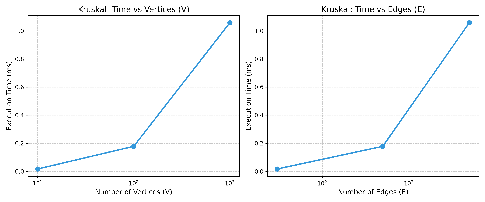
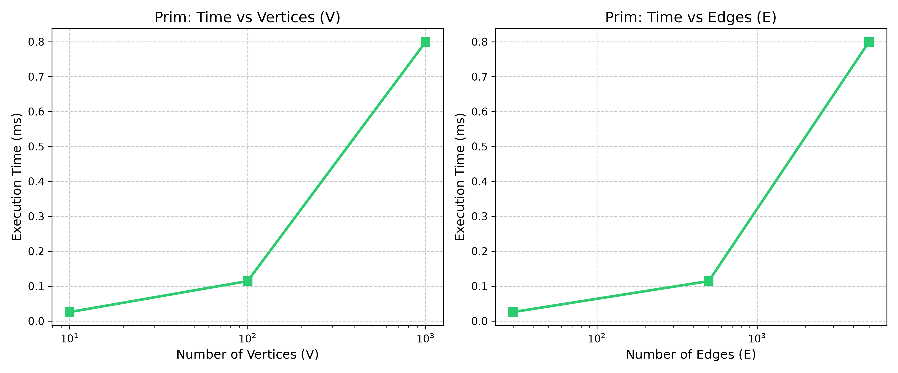
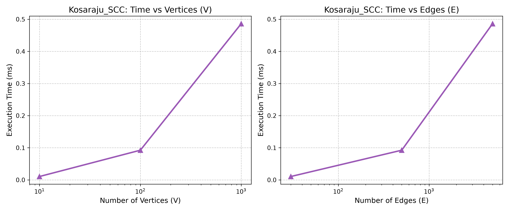
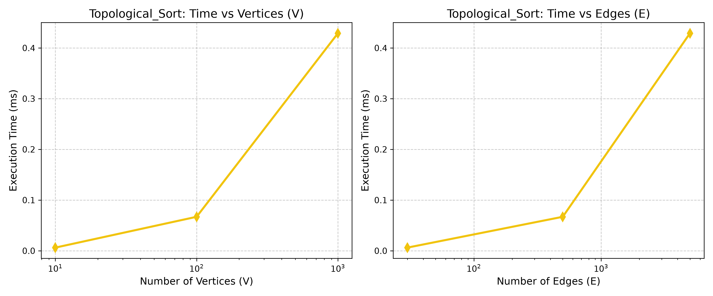
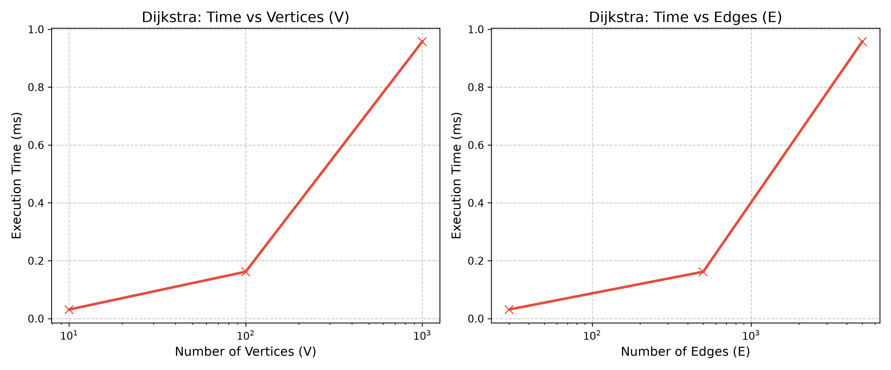

# Assignment 3 — Smart City Infrastructure and Route Planning
Temkeshev Aldiyar, SE-2527
## Overview
This project models a smart city's infrastructure network using graph data structures. The vertices represent city districts or locations, and the edges represent roads or infrastructure connections between them. 

To store the graph, an **Adjacency List** (`List<List<Edge>>`) representation is used. The `Graph` class supports adding both directed and undirected edges, allowing a single unified structure to be used across all tasks (MST, SCC, Shortest Paths).

## Implementation

* **Edge & Graph**: Fundamental structures. The `Edge` class implements `Comparable<Edge>` to allow seamless sorting by weight for greedy algorithms.
* **DisjointSetUnion (DSU)**: Optimized with two main techniques: Path Compression and Union by Rank. The `union` method returns a boolean, simplifying cycle detection in Kruskal's algorithm.
* **Task 1 (MST)**: 
  * **Kruskal's Algorithm**: Utilizes `Collections.sort()` and the DSU implementation to greedily pick safe edges.
  * **Prim's Algorithm**: Uses a `PriorityQueue` to build the tree step by step from a starting vertex.
* **Task 2 (Connectivity)**:
  * **Topological Sort**: Implemented via Kahn's Algorithm using an in-degree array and a `Queue`. It successfully detects cycles by comparing the final sorted list size to the number of vertices.
  * **Kosaraju's Algorithm (SCC)**: Implemented in three steps: a first DFS pass for post-order exit times, graph transposition (edge reversal), and a second DFS pass to extract Strongly Connected Components.
* **Task 3 (Shortest Paths)**: 
  * **Dijkstra's Algorithm**: Implemented using a `PriorityQueue`. It includes a `parent` array to trace and reconstruct the shortest paths via the `getPathTo(target)` method. It also explicitly throws an exception if negative edge weights are encountered.

## Complexity Analysis

| Algorithm | Time Complexity | Space Complexity | Justification |
| :--- | :--- | :--- | :--- |
| **DSU (find/union)** | O(alpha(V)) | O(V) | The inverse Ackermann function (alpha) is effectively O(1) due to path compression and union by rank. |
| **Kruskal (MST)** | O(E log E) | O(V + E) | Dominated by the edge sorting step. DSU operations take O(E * alpha(V)). |
| **Prim (MST)** | O(E log V) | O(V + E) | In the worst case, every edge is added to the PriorityQueue, and extracting the minimum takes O(log V). |
| **Topological Sort** | O(V + E) | O(V) | Kahn's algorithm processes every vertex and every edge exactly once. |
| **Kosaraju (SCC)** | O(V + E) | O(V + E) | Two DFS passes take O(V + E). Generating the transposed graph requires O(V + E) space. |
| **Dijkstra** | O(E log V) | O(V + E) | Similar to Prim, using a PriorityQueue requires O(log V) per edge relaxation step. |

## Experimental Setup
Experiments were conducted using graphs of three different configurations:
* **Small**: V = 10, E = 30
* **Medium**: V = 100, E = 500
* **Large**: V = 1,000, E = 5,000

A fixed random seed (`SEED = 42`) was used across all benchmarks to ensure reproducibility. Specialized graph generators were implemented:
1. **Connected Undirected Graphs**: Generates a random spanning tree first to guarantee 100% connectivity, then fills the remaining quota with random edges.
2. **Directed Graphs with Cycles**: Generates random directed edges.
3. **Directed Acyclic Graphs (DAG)**: Edges are strictly directed from a vertex with a smaller index to a vertex with a larger index (u < v), strictly preventing any cyclic dependencies.

Execution time was measured using `System.nanoTime()` and averaged over 5 runs (RUNS = 5) with a JVM warmup phase prior to the actual measurements.

## Results

### Table 1: Minimum Spanning Tree (Kruskal vs Prim)
| Size | V | E | Kruskal Time (ms) | Kruskal Ops | Prim Time (ms) | Prim Ops | Weight Matches? |
| :--- | :--- | :--- | :--- | :--- | :--- | :--- | :--- |
| Small | 10 | 30 | 0.0173 | 46 | 0.0257 | 40 | true |
| Medium | 100 | 500 | 0.1785 | 1883 | 0.1143 | 826 | true |
| Large | 1000 | 5000 | 1.0580 | 21045 | 0.7993 | 8588 | true |

### Table 2: Connectivity (Kosaraju SCC & Topological Sort)
| Size | V | E | Kosaraju Time (ms) | Kosaraju Ops | SCC Count | Topo DAG Time (ms) | Topo Has Cycle? |
| :--- | :--- | :--- | :--- | :--- | :--- | :--- | :--- |
| Small | 10 | 30 | 0.0105 | 120 | 2 | 0.0062 | true |
| Medium | 100 | 500 | 0.0924 | 1800 | 2 | 0.0670 | true |
| Large | 1000 | 5000 | 0.4860 | 18000 | 17 | 0.4289 | true |

### Table 3: Dijkstra's Algorithm
| Size | V | E | Dijkstra Time (ms) | Dijkstra Ops | Reachable from 0 |
| :--- | :--- | :--- | :--- | :--- | :--- |
| Small | 10 | 30 | 0.0313 | 76 | 10 / 10 |
| Medium | 100 | 500 | 0.1620 | 1209 | 100 / 100 |
| Large | 1000 | 5000 | 0.9574 | 11980 | 1000 / 1000 |

### Plots
**Task 1: Minimum Spanning Tree**

**Task 2: Connectivity & SCC**

**Task 3: Shortest Paths**

## Comparison and Discussion
**Kruskal vs Prim**: Both algorithms correctly return identical MST weights. Prim's algorithm demonstrates slightly better execution times on dense graphs, as it avoids the O(E log E) full edge sort required by Kruskal. However, Kruskal performs fewer absolute operations ("Ops") since its DSU operations operate in near O(1) time.

**Kosaraju SCC & Topological Sort**: Kosaraju's algorithm successfully handles O(V + E) performance and groups all vertices into strongly connected components accurately, despite the overhead of allocating memory for a transposed graph. Kahn's Topological Sort proved highly efficient for DAGs and consistently detected cycles in cyclic graphs due to the final validation check (`order.size() != V`).

**Dijkstra's Algorithm**: Runs efficiently using a greedy approach. Once it visits a vertex, it assumes the shortest path to it is found and locks it in. Because of this, the algorithm **cannot handle negative edge weights**. A negative edge later in the network could create a cheaper route to an already "locked" vertex, which breaks the algorithm's logic.
## Testing
To ensure robustness, a dedicated `TestRunner.java` class was created to verify all required edge cases:
1. **Single Vertex Graph**: Handled without exceptions (MST weight = 0, Dijkstra distance = 0).
2. **Disconnected Graphs & Unreachable Vertices**: Kruskal and Prim correctly flag `isConnected = false`. Dijkstra correctly leaves distances to unreachable vertices as `Infinity`.
3. **Duplicate Edge Weights**: Multiple valid MSTs with the same weights (e.g., an equilateral triangle) are handled properly; Kruskal and Prim return identical total weights.
4. **DAGs and Cyclic Graphs**: Topological ordering succeeds for DAGs. When cycles are introduced, Kahn's algorithm safely catches them, clears the sorted output, and sets `hasCycle = true`.
5. **SCC Coverage**: Verified that the sum of vertices across all identified Strongly Connected Components equals exactly the total number of vertices $V$.

## Conclusion
* **Kruskal and Prim** are highly effective for connecting city districts with minimal budget, with Kruskal excelling in sparse road networks and Prim in dense ones.
* **Kosaraju's Algorithm** is essential for mapping closed circulation zones (e.g., identifying trapped one-way neighborhoods).
* **Topological Sort** is ideal for managing infrastructure dependencies and scheduling construction phases.
* **Dijkstra's Algorithm** is the standard for shortest-path route planning for emergency services, provided all road distance weights are strictly non-negative.
